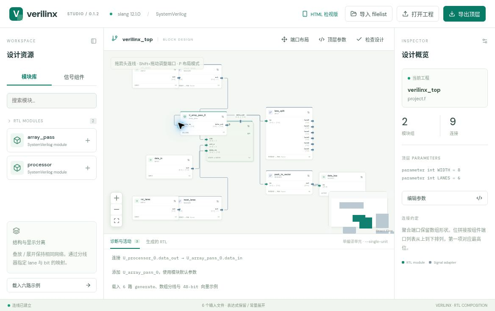
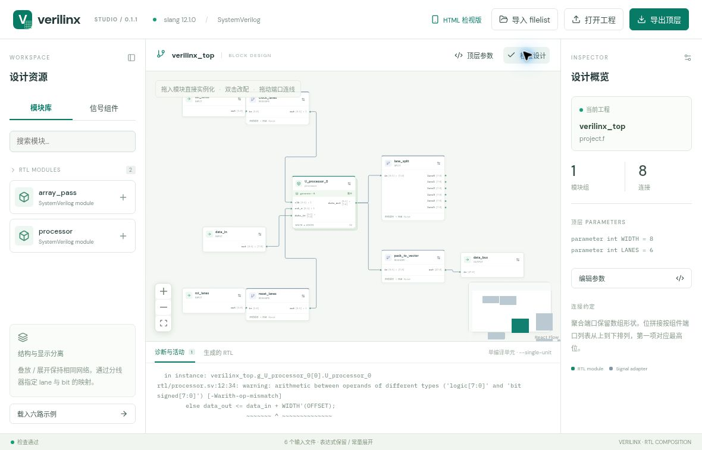

# 更新记录

## 0.1.2

- 端口改为方向箭头：输入指向模块，输出离开模块；支持鼠标拖线及先点输出、再点输入。
- P 切换端口布局，拖动箭头沿四边连续移动；也可 Shift+拖动，Shift+方向键微调。Esc 退出布局。
- 端口位置保存在顶层工程注释区，连线同步跟随，原有工程兼容。
- 不兼容形状、已有驱动、聚合/lane 重叠给出明确提示，支持输出扇出。
- 新增 Linux x86_64 独立包，内置 Python/slang 和两个前端，支持 glibc 2.31+。
- 新增 GitHub Pages 发行下载页及仅含发行产物的 `linux-release` 分支；公开仓库中的分支仍然公开。

20 项后端、10 项前端测试通过。Linux 包在无 Python/Node 的 Debian 11 容器中通过非 root 自检，真实浏览器通过移动端口后继续连线验收。



## 0.1.1

修复主画布载入示例或新增节点后仍然空白的问题。

原因是前端受控节点状态丢弃了 React Flow 的 `measured` 尺寸，库随后把所有节点重置为未初始化并隐藏。改为保存完整 React Flow 节点状态，在参数、选中状态和 generate 视图变化时保留尺寸；等待节点初始化后再恢复/适配视口。

新增四项前端回归，覆盖尺寸保留、新增、拖动/位置恢复、展开收起和删除。浏览器验证了节点和连线实际可见，而非仅验证后端返回数据。

Python 依赖不变。使用旧包的用户可以只替换 `frontend/dist`，重启服务后在浏览器强制刷新；无需安装 Node.js，也无需更改已经保存的顶层工程。

### 已有运行包快速更新

不需要重装 Python 依赖或 Node.js。先在运行服务的终端按 Ctrl+C，然后在原来的 verilinx 项目目录执行：

```sh
curl -fL https://raw.githubusercontent.com/SuperiorLQF/verilinx/main/downloads/verilinx-canvas-fix-0.1.1.zip -o /tmp/verilinx-canvas-fix.zip
unzip -o /tmp/verilinx-canvas-fix.zip
.venv/bin/python -m uvicorn backend.main:app --host 127.0.0.1 --port 3000
```

浏览器 Ctrl+Shift+R 强制刷新，左上角显示 `STUDIO / 0.1.1`。此补丁只覆盖构建后的前端和更新说明，不修改用户工程。


