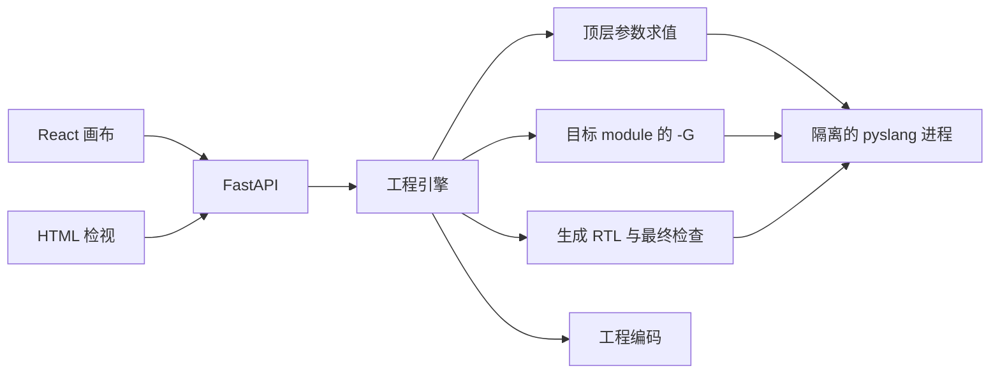

# Verilinx 开发文档

版本 0.1 · 2026-11-17。本文描述实际实现及明确的 demo 边界。

## 1. 产品合同

单入口全量 filelist，允许 `-f/-F` 嵌套；保存原文，不以打平清单替代。源码在 slang 单编译单元中处理。模块库列出定义；拖入/添加时才创建实例，使用默认参数且不弹窗。默认名称为 `U_<module>_<n>`，可双击修改。

顶层参数按行输入，不要求逗号或分号。实例覆盖表达式在顶层上下文先求真实值，再以 `-G` 分析子模块。generate 指定数量表达式，索引为 `i`。数组和向量通过显式适配器连接。

顶层 `.sv` 同时携带工程。恢复不依赖原始服务器目录。React 主画布和独立 HTML 检视客户端共享后端；编辑状态各自独立。

## 2. 目录与架构

| 文件 | 责任 |
| --- | --- |
| `backend/main.py` | API、导入、快照、静态前端服务 |
| `backend/engine.py` | 参数规范化、两阶段分析、图检查、RTL、工程编解码 |
| `backend/slang_worker.py` | 隔离的 pyslang Driver，唯一 HDL 语义执行层 |
| `frontend/src/` | TypeScript / React / React Flow 画布 |
| `review/` | 无需构建的 HTML/CSS/JS 检视客户端 |
| `examples/` | 六路 generate、宏边界及数组模块 |
| `tests/test_engine.py` | 引擎和 HTTP 回归 |
| `scripts/bundle.py` | 移动端上传用 JSON 文件包 |



每次请求发送完整 project。后端无全局工程会话；临时目录物化输入，每次 slang 操作运行于子进程。这样原生 `-F` 内部改变工作目录不会污染 API 主进程和并发请求。不经 shell 执行用户表达式。

## 3. Filelist 与宏语义

### 原生解释

复用 slang Driver 的命令文件解析，不使用逐行 split 模拟工具：处理嵌套、引号、转义、注释、宏选项、包含目录、环境变量和库文件。

入口使用 `-f`，当前目录为项目根。`-f` 相对当前工作目录；`-F` 相对所属命令文件。混合嵌套忠实保留原生语义。保存时各文件原文分别存入 `inputs.files`；运行时展开仅为分析过程。

Python `Driver.parseCommandLine` 字符串需要带程序名 `slang`，否则第一个 token 会被跳过。这一细节由宏边界回归保护。

### 单编译单元

始终启用 `--single-unit`：

```text
define_subsys.v
-f subsys.f
undef_subsys.v
```

源码 `` `define `` 影响后续普通输入，`` `undef `` 删除宏。子 filelist 不产生作用域，也不恢复宏旧值。`-v` 库文件仍遵循 slang 的独立编译单元规则。

filelist 的 `+define/-U` 是编译配置，不是夹住文件的作用域操作；不能与源码宏文件混为一谈。

求值临时模块追加在输入末尾。只有此位置有效的宏可用于用户参数表达式；子系统内部曾存在、之后被取消的宏不自动注入。

### 快照与路径

服务端目录导入从 Driver 命令文件元数据和 SourceManager 收集实际依赖。上传则保留全部提交的文本文件。快照需在全新临时目录独立解析，防止暗中读取原目录。

项目根必须覆盖依赖。支持相对路径和显式相对环境变量映射，例如 `env={"RTL_ROOT":"rtl"}`。保留 filelist 中 `${RTL_ROOT}` 原文。不自动改写硬编码绝对路径；逃出归档目录的依赖会被拒绝。

## 4. 参数分析合同

### 输入语法

```text
parameter int unsigned WIDTH = 8
parameter int LANES = 6
parameter int TOTAL = WIDTH * LANES // comment
```

每个物理行一条 parameter。软件在行尾注释之前补分号，保留空行和整行注释，也接受已有分号。多行声明、跨行表达式及复杂内联块注释不是首版编辑语法。

原文是工程的保存依据；Python 不求 HDL 表达式。slang 诊断目前以原始文本呈现，尚无编辑器行列高亮映射。

### 两阶段处理

1. 读取目标 module 默认参数类型。
2. 将顶层 parameter 和待求值表达式放入临时求值 module 的 localparam。
3. 对显式类型的参数，使用目标类型作为求值上下文；未指定类型时由表达式推导。
4. 从 ConstantValue/SVInt 序列化带位宽、符号及 X/Z 的常量。
5. 通过 `--top` 和 `-G` 分析目标 module，读取实际端口。
6. 若覆盖改变另一个参数的类型，重求值直到类型稳定，最多四轮，超过则失败。

目标类型上下文非常重要：`parameter int P` 覆盖为 `4'b1111 << 1` 应得到 30，而不是先截为 4 位得到 14。`logic [W-1:0] MASK` 中 W 改变后也需重新计算 MASK 类型。

工程保存表达式 `WIDTH * 2`，分析缓存保存当前常量。最终 RTL 使用 `.WIDTH(WIDTH * 2)`。覆盖名不存在时失败，不忽略拼写错误。默认参数无法展开的模块当前不能直接添加，后续需增加「待配置」节点状态。

### Generate

数量表达式须求得 1..64 的已知整数。每份求值上下文中加入 `localparam int i=<lane>`；相同覆盖配置在单次分析中复用结果。

同构组的聚合端口增加 unpacked 维 `[0:count-1]`。展开后保留聚合端口，同时提供 `port@lane`。异构组仅提供独立 lane 端口，默认展开。异构 RTL 通过条件 generate 分支保留各路不同声明，实例层级多一层 `lane_n`。

生成循环使用 `i`；启用 generate 时，不允许同名顶层参数。显示切换只修改 `view`，不改变网络。

## 5. 工程模型

```json
{
  "schema":1,
  "name":"verilinx_top",
  "parameters":"parameter int WIDTH = 8",
  "inputs":{"entry":"project.f","files":{"project.f":"-F lists/subsys.f\n"},"env":{},"singleUnit":true},
  "nodes":[{
    "id":"stable-id","kind":"module","name":"U_processor_0",
    "module":"processor","overrides":{"WIDTH":"WIDTH"},
    "count":"6","view":"stacked","position":{"x":400,"y":180}
  }],
  "edges":[{
    "id":"edge-id","source":"source-node","sourcePort":"out",
    "target":"stable-id","targetPort":"data_in@0"
  }]
}
```

实际包含完整输入文件、模块目录、编译器版本和可重建 analysis 缓存。导出必须重新分析，不能信任旧缓存。UUID 与用户可编辑名称分离。

形状示例：

```json
{"packed":[[7,0]],"unpacked":[[0,5]],"atom_width":1,"signed":false}
```

表示六个 unpacked 元素，每个八位。int 等原子宽度独立保存。模块方向来自 slang；组件角色为 source/target。顶层 input 在图中是 source，顶层 output 是 target。

## 6. 信号组件与位序

split、concat、reshape 是静态布线组件，不是带选择信号的时序 Mux/Demux。

映射步骤：分别按输入、输出端口列表顺序枚举；各维从声明左界到右界，先 unpacked 再 packed；整数原子从 MSB 到 LSB；两侧 bit 序列逐位对应。总位数必须相同。第一端口对应最高位。

`logic [7:0] x [0:5]` 转为 `[47:0] y` 时，`x[0]→y[47:40]`、`x[5]→y[7:0]`。若要反序，明确重排端口。画布上下位置不决定电气位序。未使用的分线输出可以不连接。

当前逐 bit `assign` 便于审核非零/递增范围，后续可以优化成切片，必须维持位映射回归。

同一输出可扇出。每个目标物理 bit 至多一个驱动，aggregate 与 lane 共享物理 bit，重复覆盖会失败。直接连接要求 packed/unpacked 范围和原子位宽一致；总 bit 数相同但形状不同也要显式 reshape。

检查还包括：非法名称、名称/ID 重复、无效端点、方向错误、适配器位宽不同、必需输入未完全驱动。分析返回未连接警告；导出拒绝。最后用 slang 编译生成顶层。不会隐式把输入接零。没有做 CDC、复位语义、跨模块组合环路或功能仿真。

## 7. 工程编码

```systemverilog
endmodule
// verilinx prj begin
// format: 1 zlib+base64 sha256:<64 hex characters>
// <Base64 payload, 100 characters per line>
// verilinx prj end
```

紧凑、键排序 UTF-8 JSON → 对原 JSON 求 SHA-256 → zlib → Base64。全部参数、源文件/filelist 原文、布局、显示方式、端口与网络都包含在内。

解码校验唯一块、版本、注释前缀、Base64、完整压缩流、解压大小和校验和。支持 CRLF。拒绝重复块、格式升级和损坏内容。解压后最大 16 MiB。

校验和用于损坏检测，不认证作者。手改 RTL 区域不会自动更新图；重新打开时以注释区工程为准。当前不提供源文件增量合并。

## 8. API

所有数据为 JSON。错误返回 422 `{"detail":"..."}`。

| 方法与路径 | 输入 | 结果 |
| --- | --- | --- |
| GET `/api/health` | 无 | 健康状态、slang 版本 |
| POST `/api/import` | filelist、files 或 directory，可选 env | 新 project |
| GET `/api/demo` | 无 | 六路示例 |
| POST `/api/component` | project、node | 校验适配器并返回节点 |
| POST `/api/parameters` | project | 顶层参数检查 |
| POST `/api/instance` | project、node | 求值并分析后的 node |
| POST `/api/analyze` | project | project、rtl、warnings、diagnostics、ok |
| POST `/api/export` | project | filename、text、diagnostics |
| POST `/api/restore` | text | 解码并校验输入后的 project |

环境变量导入例子：

```json
{"filelist":"project.f","files":{"project.f":"${RTL_ROOT}/m.sv\n","rtl/m.sv":"module m; endmodule\n"},"env":{"RTL_ROOT":"rtl"}}
```

服务只用于受信任本地开发环境。没有互联网多租户认证、工程权限和沙箱化的不受信任 EDA 执行服务。

## 9. 限制与下一阶段

- 输入文本/工程解压后 16 MiB；128 节点；每组 64 份 generate；信号 65536 bit；packed/unpacked 各最多四维。
- 每个 slang 子进程 25 秒超时，完整请求可能包含多个子进程。
- 不支持 interface/modport、inout/ref、动态数组、结构体/枚举端口、类型/字符串/实数参数、综合与仿真。
- 无跨请求分析缓存、撤销历史、多人协作及任务队列。
- Python 直接依赖固定版本，前端保留 package-lock.json。

**当前导出是按默认参数专化的布线。** 模块覆盖保留原表达式，但连接信号的范围、适配器和逐 bit 映射为当前求值结果。因此不支持在软件之外任意覆盖顶层参数后仍自动重构布线。应在编辑器修改后重新分析、调整组件并重新生成。下一阶段需要符号 shape 和映射 IR，才能提供通用参数化 IP 导出。

继续开发顺序：符号形状 → GUI 诊断定位/待配置节点/撤销 → 可视化切片和批量 lane 连线 → filelist 来源位置与重绑定 → 分析缓存/队列 → 协议总线和仿真。

## 10. 验证

```sh
.venv/bin/python -m pytest -q
npm --prefix frontend run build
node --check review/app.js
```

自动回归覆盖：嵌套 filelist 宏边界、编译选项宏全局性、目标类型上下文、参数相关类型、X/Z、未知参数、异构 generate、数组位序、驱动重叠、缺失连接、编码恢复/损坏、路径越界及共享 API。

人工验收：

1. 载入六路示例，确认画布节点和边。
2. 拖入默认模块，不弹窗；双击设置参数及实例名。
3. 修改 WIDTH，端口刷新；已有不兼容连接明确报错。
4. generate 叠放/展开后网络不变；lane 可单独连接。
5. 同接 aggregate/lane，检查必须拒绝重叠。
6. 配置 split/concat 的端口次序，核对 RTL 位序。
7. 两前端互相导出/恢复，比较源码和设计数据。
8. 手机端通过表单和下拉端点完成接线、检查和导出。
9. 错误表达式不覆盖上一次成功的实例分析。

后端 18 项回归通过。0.1.1 新增 4 项画布状态回归，并在真实浏览器验证示例加载、节点可见性、generate 展开、模块新增和改参；手机设备仍需验收。

## 11. 上游参考

- [slang 用户手册](https://www.sv-lang.com/user-manual.html)
- [slang 命令行](https://www.sv-lang.com/command-line-ref.html)
- [slang Driver](https://github.com/MikePopoloski/slang/blob/master/source/driver/Driver.cpp)
- [slang Preprocessor](https://github.com/MikePopoloski/slang/blob/master/source/parsing/Preprocessor.cpp)
- [React Flow](https://reactflow.dev/)

升级 slang 时必须重跑语义回归，不能仅以 import API 成功视为兼容。

发布配置与 Windows 启动说明见 [运行与部署](DEPLOYMENT.md)。HTTPS gate 和健康检查也有回归覆盖。

## 12. 0.1.1 画布状态修复

React Flow 的受控节点必须保留 `measured` 尺寸。旧实现仅保存位置，每次从领域节点重建渲染节点都丢弃尺寸，导致内部初始化重置，DOM 永久 `visibility: hidden`。现在使用 `useNodesState` 保存完整渲染状态，`reconcileCanvasNodes` 在领域数据更新时保留尺寸和拖动位置。尺寸是运行时 UI 数据，不写入工程模型。加载或恢复工程时，仅恢复文件中保存的位置和视口，等待节点实际测量完成后再适配视图，不依赖固定延迟。

运行 `npm --prefix frontend test` 可验证尺寸跨数据/选择更新保留、新增节点、拖动/恢复位置，以及展开收起重新测量和删除。
